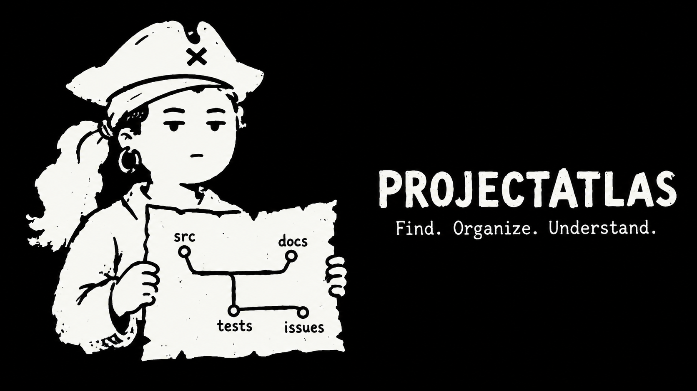
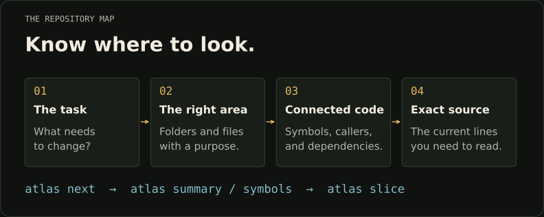
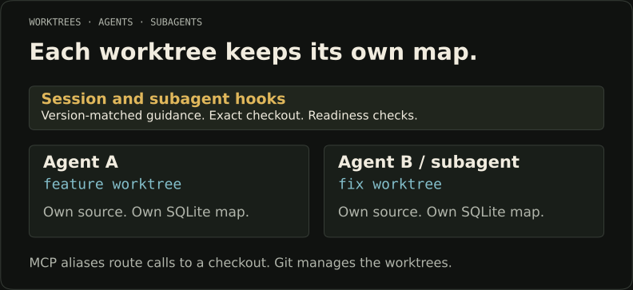
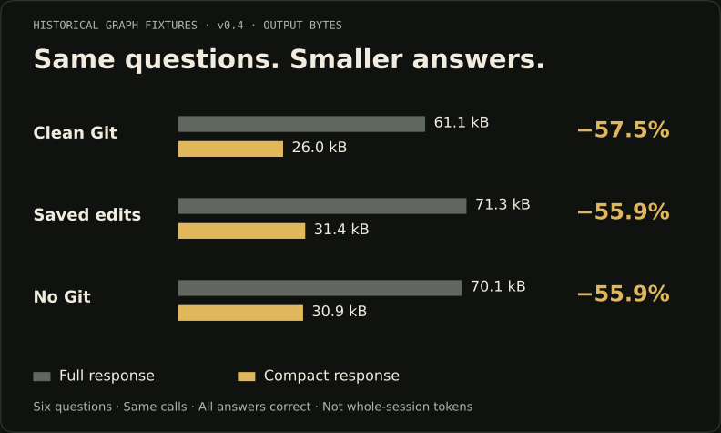
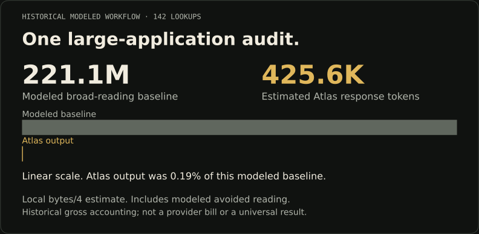
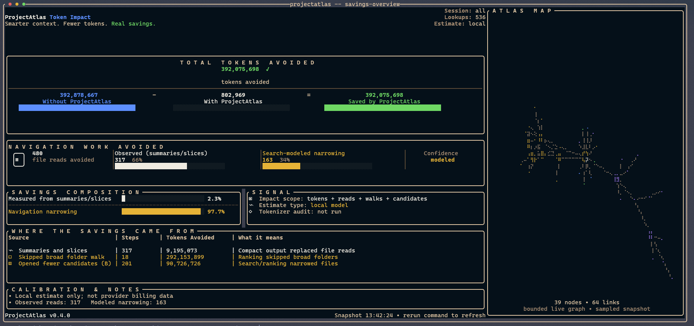

<p align="center">
  <a href="docs/design/ani-mascot-reference.png">
    
  </a>
</p>

<h1 align="center">A map for your coding agent.</h1>

<p align="center">
  <strong>Every file not opened. Every folder not explored. Tokens saved.</strong>
</p>

<p align="center">
  <a href="https://github.com/styler-ai/ProjectAtlas/releases/tag/v0.5.0"></a>
  <a href="https://github.com/styler-ai/ProjectAtlas/actions/workflows/ci.yml"></a>
  
  
</p>

<p align="center">
  <a href="#install">Install</a> · <a href="#work-in-parallel">Worktrees &amp; subagents</a> · <a href="#smaller-context">Charts</a> · <a href="docs/v0.5.0-release-notes.md">0.5.0</a> · <a href="#documentation">Documentation</a>
</p>

A coding agent needs to know where to look before it can make a change. **ProjectAtlas keeps a map of the repository:** what each area is for, how the code connects, and where the relevant source lives. The agent follows that map and opens the code it needs.

The map stays on your machine, in a project-local SQLite database. Use it from the native `atlas` CLI or through MCP in Codex, Claude Code, OpenCode, and other compatible agents.

## Start with the map

<p align="center">
  
</p>

Folder and file purposes explain responsibility. Summaries and outlines show what is inside. Symbol relationships lead to connected code. Exact slices give the agent current source lines to check its answer.

```bash
atlas next "where is watch refresh implemented?"
atlas summary crates/projectatlas-cli/src/runtime.rs
atlas symbols relations --file crates/projectatlas-cli/src/runtime.rs
```

The native CLI covers local navigation, search, indexing, graph analysis, purposes, health, and maintenance. MCP adds session briefs, registered worktree aliases, and queries across worktree maps. Both use the same index and underlying services.

## Work in parallel

<p align="center">
  
</p>

**Each worktree keeps its own map.** An agent can address registered worktrees by short MCP alias, inspect connections across them, and reuse a validated baseline when a new worktree needs its first index. Branches, saved edits, purposes, and database identities remain separate.

**Subagents get the guidance too.** The Codex plugin includes session and subagent hooks that remind agents to read the matching ProjectAtlas skill and select their own checkout. Readiness checks report a stale runtime, plugin, or database binding and point to the supported repair. The hook itself does not index or change the project.

ProjectAtlas works with the coding host's agents and subagents. Git continues to manage the worktrees. [Worktree guide](docs/worktree-lifecycle.md) · [Hooks and host setup](docs/agent-integration.md#codex-skills)

## Follow the code

| What you need to know | What the map gives you |
| --- | --- |
| Where a change belongs | Reviewed folder and file purposes, ranked candidates, summaries, and outlines. |
| What a change could affect | Callers, imports, references, dependency paths, and bounded impact analysis. |
| Where structure needs attention | Cycles, entry points, related groups of code, and dead-code candidates with coverage information. |
| How the docs connect to the source | Indexed Markdown, PDF, and DOCX content, heading links, and source relationships. |
| What changed since the last visit | Ignore-aware scanning, file watching, and incremental refresh of the saved working tree. |
| What evidence supports an answer | Exact source locations, parser provenance, and visible unresolved or incomplete results. |

Search supports literal, regex, and fuzzy queries, including Unicode-aware case-insensitive matching. Health and purpose queues help maintain the map as the project changes.

The graph describes static source facts. Results keep unresolved references and coverage limits attached, including when reviewing dead-code candidates. [Graph and navigation guide](docs/agent-navigation.md)

## Smaller context

A focused answer leaves more room for the code the agent actually needs.

<p align="center">
  
</p>

In this retained fixture evaluation, compact graph responses used **55.9–57.5% fewer bytes**. The calls and correct answers stayed the same. These are response-size results, not complete-session token counts. [Data and method](docs/benchmarks/v0.4-mcp-composition-evaluation.md)

<p align="center">
  
</p>

One large-application audit recorded a **99.8% gross estimated reduction** against a modeled broad-reading baseline. This is a historical workflow estimate, not provider billing. Current reporting also deduplicates repeated baselines. [Audit, formulas, and limits](docs/benchmarks/large-application-token-savings.md) · [Controlled agent trials, including mixed results](docs/benchmarks/v0.4-agent-navigation-evaluation.md)

## See your own usage

```bash
atlas token --view tui
```

[](docs/assets/token-impact-tui.png)

An example dashboard snapshot. The report separates observed source compression from modeled navigation and shows where the estimates came from. Control-checkout totals can include active and retired registered worktrees; an exact worktree report stays local. [Token reporting](docs/agent-integration.md#token-reporting-and-human-tui)

## Languages and documents

Built-in navigation covers Rust, Python, JavaScript, TypeScript, Java, Kotlin, C#, Go, C/C++, Objective-C, Zig, PHP, and PowerShell, with language-specific levels of parsing, symbols, and resolution. Vue and documentation have dedicated handling too.

The optional parser pack contains **150 grammars**, including COBOL and Fortran, for Linux x64 and Windows x64. Grammar availability, symbol extraction, and semantic resolution are separate capabilities. The generated [language matrix](docs/language-support.md) and [relation matrix](docs/relation-support.md) show the exact coverage.

Broader ABAP, COBOL, Fortran, Ruby, and SQL navigation is planned for [0.6.0](https://github.com/styler-ai/ProjectAtlas/issues/563).

## In 0.5.0

- Built-in PHP 8 navigation and bounded PDF/DOCX text extraction, with source evidence and coverage reporting.
- The short native `atlas` command, matched runtime/plugin installation, generated host configurations, and packaged hook readiness checks.
- Entry-point and related-code analysis through the existing graph tools, plus Unicode-aware search corrections.
- Preserved worktree identity, authored purposes, and valid published index state through supported refreshes and upgrades.

[Release notes](docs/v0.5.0-release-notes.md) · [Native packages](https://github.com/styler-ai/ProjectAtlas/releases/tag/v0.5.0)

## Install

**Point your coding agent at this repository and ask it to install ProjectAtlas, preferably with the marketplace plugin.**

> Install ProjectAtlas from https://github.com/styler-ai/ProjectAtlas for this project. Prefer the marketplace plugin and follow its installation instructions.

**Then restart your terminal and coding environment.** This reloads the installed commands, plugin guidance, and MCP process. Open the project again and tell the agent: **“Use ProjectAtlas for this repo.”**

### Codex marketplace plugin

```bash
codex plugin marketplace add styler-ai/ProjectAtlas --ref v0.5.0
codex plugin add projectatlas --marketplace projectatlas
```

The plugin packages the version-matched skill, hooks, native runtime installer, and MCP templates. Follow its installer instructions so the runtime, host configuration, and selected repository agree.

### Other setups

| Setup | Route |
| --- | --- |
| Native CLI | [Verified release binaries](https://github.com/styler-ai/ProjectAtlas/releases/tag/v0.5.0) for Windows x64, Linux x64, macOS Intel, and Apple Silicon. No Rust toolchain required. |
| Claude Code / OpenCode | The native installer writes project-local MCP configurations for these hosts. [Setup guide](docs/agent-integration.md#runtime-installation-and-repair). |
| Cargo | `cargo install --git https://github.com/styler-ai/ProjectAtlas --tag v0.5.0 projectatlas-cli --locked` |

Initialize each repository once with `atlas init`. After edits, use `atlas watch --once` when a refresh is needed, or keep `atlas watch` running while you work. Each checkout owns its database; no source headers or `.purpose` files are required.

[Installation, upgrades, and runtime repair](docs/agent-integration.md#runtime-installation-and-repair)

## Documentation

[Agent setup and MCP](docs/agent-integration.md) · [CLI workflow](docs/workflow.md) · [Configuration](docs/configuration.md) · [Worktrees](docs/worktree-lifecycle.md) · [Graph navigation](docs/agent-navigation.md) · [Architecture](docs/projectatlas-3-architecture.md) · [Language coverage](docs/language-support.md) · [Ecosystem catalog](https://styler-ai.github.io/ProjectAtlas/language-support/) · [Published docs and Rust API](https://styler-ai.github.io/ProjectAtlas/)

## License

[MIT](LICENSE).
