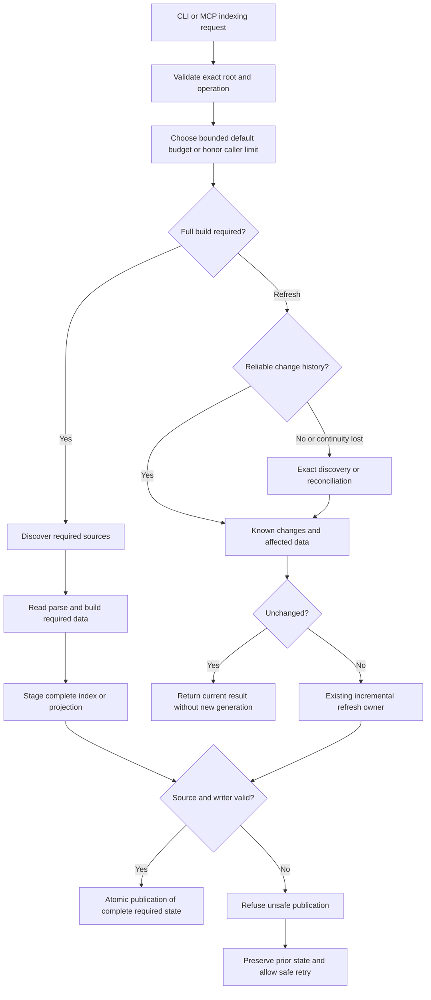

# Indexing and incremental refresh

This documents the 0.5.1 issue #708 behavior: faster initial indexing, full reindexing, symbol/graph rebuilding and refresh. The implementation retains exact one-shot reconciliation. The complete four-platform installed campaign passed all 1,441 original assertions and its prepublish workflow; results and retained earlier failures are in the [indexing reference](benchmarks/v0.5.1-indexing.md#accepted-installed-candidate-complete-original-targets). Final issue review, normal merge and RC1 release acceptance remain separate requirements.

## Shared owners and accepted behavior

- Continuous watching receives a `WatchChangeSet` and has an incremental path.
- `SourceObservationRegistry` keeps process-local source observations for some MCP reads.
- `run_single_watch_refresh_controlled` and MCP watch-once reach `refresh_index_controlled`; one-shot refresh captures exact source evidence and can transfer it to the shared mutable owner without another detection inventory.
- An unchanged one-shot pass avoids parsing and a new generation, but still walks and hashes admitted source and compares ordered source-only records without full-node decoding.
- A changed pass can stage a full publication and perform two further exact validation scans.
- Full scans use `run_scan_pipeline_controlled` to stage complete index state, revalidate inputs and publish atomically. CLI/MCP symbol rebuilding shares `run_symbol_build_pipeline_controlled`.

The focused baseline, draft and complete installed results are in [the indexing reference](benchmarks/v0.5.1-indexing.md). A read-oriented observer or empty callback queue does not safely authorize bypassing exact reconciliation.

CLI serialization chooses JSON or TOON before invoking the corresponding
renderer. Ordinary commands and tracked outputs share that boundary; coverage
and slice fitting measure the selected format's exact bytes. Directory telemetry
consumes the accepted serialized response without encoding it a second time.
This removes discarded formatting work while preserving wire schemas, output
bounds and accounting. MCP's intentional TOON responses and controlled analysis
encoders retain their existing behavior.

The CLI registers its closed command tree with Clap's deferred argument
construction at each subcommand enum. Parsing builds arguments only for the
selected command path; names, descriptions and aliases remain registered for
parent help. Consumers inspecting the complete argument tree call
`Command::build` first. This avoids unused command construction before the
existing runtime pipeline without changing command semantics or freshness.

For a current database, native-root discovery uses one storage-owned read-only
snapshot per root read.
That snapshot checks the complete live schema and current read profile, then
decodes the native identity without reopening the database for another admission.
Discovery without explicit configuration tries the native identity before asking
for a legacy recovery candidate. Explicit configuration keeps its predecessor
authority checks before filesystem configuration discovery. Settings and MCP
launch rendering retain their separate selected-root/configuration validation;
the later source, root, publication and policy checks remain independent. A later
schema change is checked again; no root result is cached across those boundaries.

The owning tests reduce complete schema inspections from two to one per
native-root read. Across the tested root-and-configuration discovery paths,
unnecessary legacy reads fall from four to zero; the explicit-configuration
fixture retains two authority-guard reads. These work counts are causal evidence
of reduced work. Installed latency and memory acceptance remain separate
requirements in [the indexing reference](benchmarks/v0.5.1-indexing.md).

## Target refresh flow

Budget admission includes discovery; do not walk the whole tree just to estimate the budget. The evidence step selects the required source evidence, not an unbudgeted scan. In RC1 every explicit CLI/MCP one-shot refresh takes the exact branch. The known-change branch represents the existing continuous watcher batch and retains final source validation; it is not a zero-source-work admission witness. A cold process may need an exact baseline; an empty new event queue says nothing about past edits. Wider reconciliation follows uncertainty or relevant policy changes. Required initial/full/rebuild work preserves its existing command semantics and cannot be replaced by an unrelated cached no-op.

Validation, cancellation or failure at any phase refuses unsafe publication and preserves prior state, including an absent initial index. Only explicit initialization creates missing project state; other routes keep their typed recovery guidance.

## Ownership and safeguards

Keep the existing filesystem, source-observation, work-control and SQLite/publication owners. Capture root, native project identity, policy and generation consistently. Integrate observation with writer checks before reusing it for publication. Do not transfer another project's database or trust size/mtime alone.

A `DependencyClosureLimit` refusal reports known unique affected source paths in
`changed`; that count is a lower bound when dependency expansion stops early.
Its `added`, `removed` and `modified` fields stay zero and unclassified because
affected dependents can have unchanged source. Graph keys, rows and bytes retain
their existing work limits rather than becoming path counts. The shared refusal
owner borrows the known paths and copies only a bounded diagnostic sample.
CLI JSON/TOON and MCP preserve the prior publication and direct recovery to an
explicit complete scan with the same root or worktree selector. Ordinary source,
path and policy drift retains watch-once recovery; ordinary source-delta counters
keep their existing categories.

Use one operation plan for trusted no-op, affected work or a required full build. Compare lightweight ordered source records with stored hashes in a linear merge; do not decode the whole stored project just to learn which source changed. Reuse captured source bytes, compatible parse facts and valid verification evidence within that plan. This architecture preserves the planned work reduction; focused measurements confirm it, with broader platform proof at release acceptance.

Read, hash, parse, decode and write counts matter alongside elapsed time. An unchanged one-shot refresh performs one exact source detection/comparison and avoids full-node decoding, parsing and a new generation. A changed refresh expands only to affected data. Initial/full indexing, explicit symbol rebuilding, cold discovery, lost events and wider invalidation have distinct measured targets. Full/rebuild benchmarks prove complete work actually ran. Preserve parser/document coverage, existing force/rebuild semantics, authored purposes and bounded workers/memory.

The user accepted shipping RC1 with exact reconciliation and measured gains. Zero-source-work admission is deferred to unscheduled [#725](https://github.com/styler-ai/ProjectAtlas/issues/725), which requires a reviewed causal history witness. A fresh CLI and long-lived MCP explicit refresh both retain exact comparison, including same-metadata and delayed-callback edits. Their own preregistered latency and work targets remain required.

Default budgets reflect estimated discovery, source bytes and affected work within documented bounds. Explicit caller limits win, cancellation remains responsive and retries do not reset the clock. Larger timeouts alone do not prove a performance improvement.

Keep the existing 1,800-second maximum and larger-request clamp. A new cold workload without a reliable estimate keeps the 1,800-second automatic budget; estimating it must not add an unbudgeted tree walk. Only omitted-limit admission becomes adaptive. Explicit limits up to the ceiling, including 1,800 seconds, keep their existing meaning.
