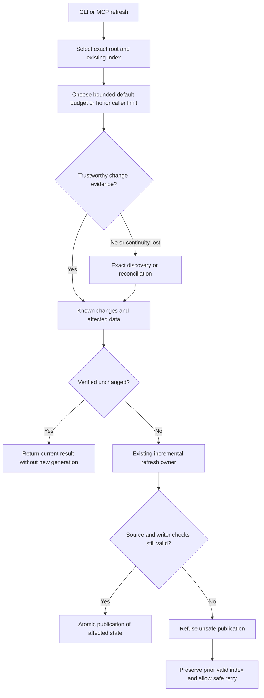

# Incremental refresh

This is the target behavior for v0.6.0 issue #708. It is a plan, not a claim that the current one-shot path is already fast.

## What already exists

- Continuous watching receives a `WatchChangeSet` and has an incremental path.
- `SourceObservationRegistry` keeps process-local source observations for some MCP reads.
- `run_single_watch_refresh_controlled` and MCP watch-once reach `refresh_index_controlled`; one-shot refresh does not receive the continuous watcher's change batch, and MCP watch-once bypasses the server observer.
- An unchanged one-shot pass avoids parsing and a new generation, but still walks and hashes admitted source and compares stored nodes.
- A changed pass can stage a full publication and perform two further exact validation scans.

The source investigation establishes these paths. It does not provide a new optimized-runtime latency baseline or prove that a read-oriented observer is safe for publication.

## Target refresh flow

Budget admission includes discovery work: the diagram's evidence step selects the kind of evidence needed, not an unbudgeted scan. A cold process may need an exact baseline; an empty new event queue says nothing about earlier edits. Wider reconciliation is justified by uncertainty or relevant policy changes, not by every ordinary refresh.

## Ownership and safeguards

Keep the existing filesystem, source-observation, work-control and SQLite/publication owners. Capture root, native project identity, policy and generation consistently. Integrate observation with writer checks before reusing it for publication. Do not transfer another project's database or trust size/mtime alone.

Read, hash, parse, decode and write counts matter alongside elapsed time. A verified no-op should not traverse the project, hash source, decode all nodes, parse files or publish a generation. A changed refresh expands only to data genuinely affected by the changes. Cold discovery, lost events and wider invalidation have separate measured cases.

The zero-work promise requires trustworthy retained observation. A fresh CLI without history has a separate measured latency target. If exact cold discovery cannot meet it, a reliable-history design must be published and reviewed before that alternative is implemented. A fast long-lived MCP route alone does not complete this issue.

Default budgets reflect estimated discovery, source bytes and affected work within documented bounds. Explicit caller limits win, cancellation remains responsive and retries do not reset the clock. Larger timeouts alone do not prove a performance improvement.
