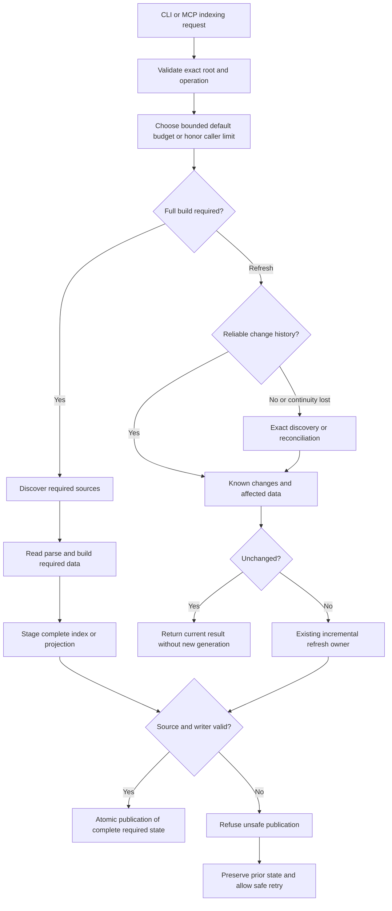

# Indexing and incremental refresh

This is the target behavior for 0.5.1 issue #708: faster initial indexing, full reindexing, symbol/graph rebuilding and refresh. Implementation and speed measurements remain pending.

## What already exists

- Continuous watching receives a `WatchChangeSet` and has an incremental path.
- `SourceObservationRegistry` keeps process-local source observations for some MCP reads.
- `run_single_watch_refresh_controlled` and MCP watch-once reach `refresh_index_controlled`; one-shot refresh does not receive the continuous watcher's change batch, and MCP watch-once bypasses the server observer.
- An unchanged one-shot pass avoids parsing and a new generation, but still walks and hashes admitted source and compares stored nodes.
- A changed pass can stage a full publication and perform two further exact validation scans.
- Full scans use `run_scan_pipeline_controlled` to stage complete index state, revalidate inputs and publish atomically. CLI/MCP symbol rebuilding shares `run_symbol_build_pipeline_controlled`.

The source investigation establishes these paths. It does not provide an optimized 0.5.0 latency baseline, profile each initial/full/rebuild phase, or prove that a read-oriented observer safely authorizes publication.

## Target refresh flow

Budget admission includes discovery; do not walk the whole tree just to estimate the budget. The evidence step selects the required source evidence, not an unbudgeted scan. A cold process may need an exact baseline; an empty new event queue says nothing about past edits. Wider reconciliation follows uncertainty or relevant policy changes. Required initial/full/rebuild work preserves its existing command semantics and cannot be replaced by an unrelated cached no-op.

Validation, cancellation or failure at any phase refuses unsafe publication and preserves prior state, including an absent initial index. Only explicit initialization creates missing project state; other routes keep their typed recovery guidance.

## Ownership and safeguards

Keep the existing filesystem, source-observation, work-control and SQLite/publication owners. Capture root, native project identity, policy and generation consistently. Integrate observation with writer checks before reusing it for publication. Do not transfer another project's database or trust size/mtime alone.

Use one operation plan for trusted no-op, affected work or a required full build. Compare lightweight ordered source records with stored hashes in a linear merge; do not decode the whole stored project just to learn which source changed. Reuse captured source bytes, compatible parse facts and valid verification evidence within that plan. This architecture establishes the expected work reduction before implementation; focused measurements confirm it, with broader platform proof at release acceptance.

Read, hash, parse, decode and write counts matter alongside elapsed time. A verified no-op should not traverse the project, hash source, decode all nodes, parse files or publish a generation. A changed refresh expands only to affected data. Initial/full indexing, explicit symbol rebuilding, cold discovery, lost events and wider invalidation have distinct measured targets. Full/rebuild benchmarks prove complete work actually ran. Preserve parser/document coverage, existing force/rebuild semantics, authored purposes and bounded workers/memory.

The zero-work promise requires trustworthy retained observation. A fresh CLI without history has a separate measured latency target. If exact cold discovery cannot meet it, a reliable-history design must be published and reviewed before that alternative is implemented. A fast long-lived MCP route alone does not complete this issue.

Default budgets reflect estimated discovery, source bytes and affected work within documented bounds. Explicit caller limits win, cancellation remains responsive and retries do not reset the clock. Larger timeouts alone do not prove a performance improvement.

Keep the existing 1,800-second maximum and larger-request clamp. A new cold workload without a reliable estimate keeps the 1,800-second automatic budget; estimating it must not add an unbudgeted tree walk. Only omitted-limit admission becomes adaptive. Explicit limits up to the ceiling, including 1,800 seconds, keep their existing meaning.
