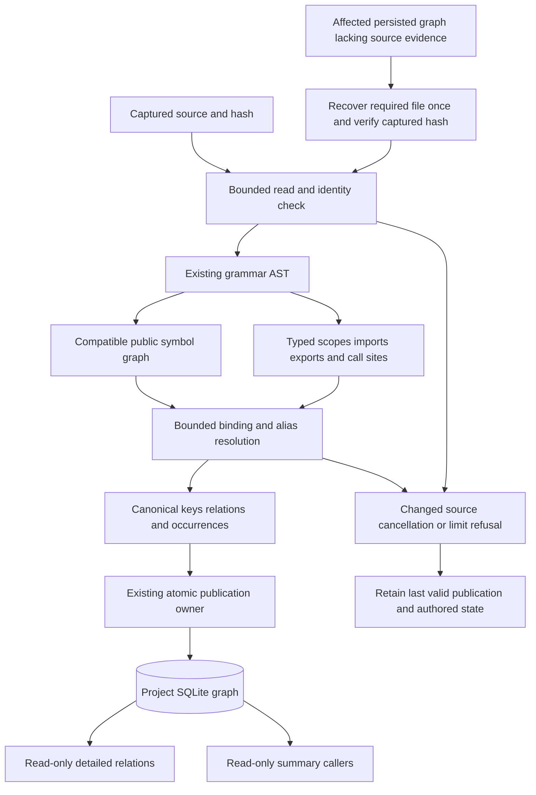

# Static binding resolution

This design records the RC1 repair contract for #731. The implementation and
verification remain tracked in `normalize-supported-import-bindings`.

## Static binding evidence and publication

The parser owns syntax and lexical evidence. Runtime owns bounded source admission,
resolution and publication. SQLite stores derived canonical outcomes; queries use
those outcomes and do not reinterpret raw names as binding proof.

Recovery is limited to evidence required by a full or affected projection and its
explicit static binding targets, cached by captured source identity. Untouched
canonical rows outside that closure remain reused. Unknown or dynamic bindings
remain unresolved. Cycles, ambiguity, parser trust and exhausted bounds never
justify a guessed exact target. Publication failures roll back under the existing
owner. Source scopes are not reconstructed from display strings at query time.

ECMAScript `var name;` reserves a function-scoped name without writing a value.
It preserves an existing function or initialized callable variable, including live
exports and explicit alias chains. A new uninitialized local still shadows outer
bindings. Actual initializers, assignments and `for-in`/`for-of` targets retain their
write semantics; lexical declarations and other language owners are unchanged.
Standalone JavaScript/TypeScript/TSX and admitted Vue/Svelte/HTML scripts share this
rule.
Malformed declarators cannot supply no-write or direct-callable initializer proof.
Check both their own recovery errors and an immediately following error/missing
node after comments; this catches a recovered equals sign outside the declarator
without poisoning independently valid comma-delimited siblings. Raw recovered
calls remain available with unsupported binding authority withdrawn.
 This is bounded lexical evidence rather than runtime control-flow inference.

Python `global` and `nonlocal` select the module or actual enclosing function
binding instead of reserving a function-local value. Reads before a write can
retain their earlier declaration or import; later writes and ambiguously timed
captured mutations cannot establish an exact callable. Assignment expressions,
iteration, deletion, imports, declarations and context/exception/match captures
share this owner policy. Directive state counts against the lexical retention
limit. Read-order state is retained only for actual directive names; comments and
files without directives do not consume that capacity. Parameter/import/member
labels and annotation scopes are distinct from ordinary value reads. Bare
annotations preserve existing values while reserving function-local names.
Class namespaces do not become closure cells; an intervening function's global
declaration blocks nonlocal lookup. This adds no Python execution or control-flow
inference.

The directive-name catalogue is shared by the file. Same-name reads in unrelated
scopes can also consume its bounded read-marker capacity; very dense files can
therefore lose exact binding proof conservatively while retaining raw navigation.
This is covered by the lexical limit rather than a claim of full Python execution
or compiler validation.

The same source-owned export evidence withholds callable keys for module names
that have been rebound, including writes through valid global directives. Importers
and canonical caller summaries follow that result while unrelated public exports
remain available. Recover required public declaration-only Python sources once
from the captured inventory before projecting their export keys; the existing
cache, remapping, cancellation and resource accounting remain authoritative.

Captured call and import byte ranges also own persisted source occurrences.
After lexical refinement and host remapping, one bounded traversal maps requested
boundaries against original source lines and Unicode-scalar columns. Projection
uses that typed range only for its admitted relation ordinal; missing evidence
retains the existing fallback span and trust. Logical edges deduplicate separately
from occurrences, so repeated same-line calls and equal-length aliases keep their
independent sites. Grouped import leaves may share their owning declaration range.
Retained fact records and projection coordinate maps count toward existing budgets.

Native Java calls retain the grammar's full callee, such as `Service.run`, rather
than losing the method name and treating `Service` as the called declaration.
Unqualified Java method names use their existing method namespace independently
from expression variables. Qualified type or receiver dispatch remains unresolved
when the collector lacks member-target proof; the presence of a same-name class
does not establish a call to that class. This repair does not add Java type flow,
field/inheritance analysis or a cross-file semantic provider.

C and Objective-C struct tags and TypeScript type aliases do not shadow callable
values. C++ constructor types occupy a separate lookup environment: an ordinary
value or function binding wins in the nearest scope, while an otherwise visible
class or struct can supply constructor evidence. Actual declaration visibility
prevents a future tag or function from stealing an earlier call. Partially visible
overload groups and lost or ambiguous declaration correspondence abstain; fully
visible overloads retain their ambiguity. This is bounded lexical evidence, not a
C++ compiler model for dependent templates, inheritance or qualified dispatch.

Member names follow each language's binding namespace. Rust impl/trait items,
Go receiver methods, ECMAScript class/object methods and Objective-C selectors do
not introduce ordinary lexical function names. Go receiver parameters remain
local blockers. Java, C++, C# and Kotlin retain supported implicit member lookup;
Python method bodies retain their class-scope boundary. Same-line declarations
use the existing emitted parent and signature to distinguish graph ordinals;
indistinguishable metadata remains ambiguous. This reuses AST identity and does
not parse display signatures or infer receiver types.

If native declaration or import capture omits binding evidence at its resource
ceiling, retained facts cannot establish exact call or exported-target authority.
Raw navigation evidence and module dependencies remain available. Filtering and
host remapping preserve this completeness boundary and competing bindings.

Explicit ECMAScript local export clauses link the module environment after
collection, including forward-declared functions and imported bindings. Export-from
and namespace-export slots carry their decoded source and exported names; their
module dependencies do not create local lexical bindings. Wildcard exports retain
only the module dependency. Runtime and type-only slots occupy separate namespaces;
duplicates invalidate only the competing runtime name, preserving independent
names for the same declaration. Rust and ECMAScript type aliases, interfaces and
traits cannot supply callable declaration keys through exported-symbol fallback.
Existing runtime class, struct-constructor and function eligibility is preserved.
An exhausted export-fact budget invalidates all export target proof, including
previously captured slots; ordinal filtering and embedded-host remapping preserve
this completeness boundary.

Extraction derivation contract 10 and semantic resolution contract 10 invalidate
older derived facts, including preceding development contracts 9/9, 8/8, 7/7, 6/6, 5/6 and 4/5 and the
published 0.5.0 contract 3/3. An ordinary refresh repairs unchanged source through
the existing bounded full-publication owner. This first reconciliation may parse
the complete admitted source; later current-contract operations reuse unaffected
facts. No database reset, schema change or authored-state migration is required.
Cancelled repair staging and failed source validation preserve the last publication;
compatible prior runtimes may reconcile their own derived contract on rollback.

Python and ECMAScript deferred bodies can use a unique later binding in an
enclosing environment. Immediate expressions, direct IIFEs, Python definition
headers and a generator's first iterable retain source-order lookup. A precomputed
stable timeline suffix prevents a deferred body from guessing between future
targets. Observed ECMAScript writes invalidate mutable call/export identities;
writes by a nested callable to a captured binding have unknown execution timing.
This does not add runtime execution or general control-flow inference.

Native traversal stops at 256 AST levels. Lexical refinement retains at most
16,384 environments and 16,384 binding transitions across value, method and type/module namespaces or pending writes per file,
independently of symbol/import/call caps. Exceeding these bounds removes binding
and export authority while preserving raw admitted evidence, source navigation
and already captured caller ownership. Unvisited ownership stays unproved.
Ordinary source reduction and refresh restore exact bindings without resetting
the project. These per-file bounds also apply when parsing runs concurrently.

Named arrow and function initializers reuse their existing emitted function
declarations, including `const`, `let` and `var`. Ordinary values, destructuring
property names and arbitrary default expressions do not establish callable
identity. Unproved exported variable owners retain blocking evidence so raw
exported metadata cannot silently restore a callable target.

Explicit ECMAScript forwarding resolves before publication through typed
module/name/member requests. A forwarding slot belongs to its exporting file and
is a lookup marker, never a call target. The final target uses the actual
declaration's complete selector. Intermediate file and module keys remain separate
invalidation causes, including unresolved cycles and missing targets, so edits or
deletion repair unchanged consumers. Required source is captured and hash-checked
once per operation; identical queries and declaration hydration share bounded
caches. Traversal stops after 64 steps; ambiguity, unsupported slots and exhausted
proof abstain. Existing direct declaration lookup keeps its fast path.

Rust source facts retain complete use paths and their item, grouped-self or
wildcard roles before classifying the final segment. Runtime selects Cargo roots
from the already parsed manifest and admitted target inventory, then proves each
module transition from actual `mod` syntax. Filenames narrow candidates but do
not establish crate membership. A manifest-only root change invalidates consumers
while the previous root file may remain indexed. Missing module alternatives and
automatic target-directory additions remain dependency causes. Conditional,
custom-path, ambiguous or unknown ownership abstains.

Rust local import groups retain all winning-scope import and declaration
competitors until publication resolves the requested namespace. Removing any
required competitor during filtering removes that group's authority. Nested
modules do not inherit bare outer lexical names; explicit anchored imports
remain supported. Function-local modules and unproved local import-root alias
contexts remain unresolved rather than borrowing a global module's address.

Rust value and type/module namespaces remain separate. Explicit root functions,
private ancestor functions, inline modules and `pub use` chains retain their actual
declarations. Tuple constructor visibility includes its fields. Type imports do
not become direct calls; supported same-source inherent methods retain their
actual impl-owned declarations. This does not add receiver type flow, trait
selection or a compiler-wide search for impl blocks.

Standard-toolchain selectors are content-free static identities, not claims that
a crate is linked or a call executes. Actual source binding proof preserves
`std`, `core` and `alloc` identities while local modules and aliases with those
spellings cannot steal that identity. Absolute paths require owning target edition:
Rust 2015 starts at the crate root; Rust 2018 and later use the extern prelude.
An unknown or inherited edition does not manufacture an absolute external target.
Unsupported attributed imports remain lexical blockers. Ordinary documentation,
lint and inline attributes preserve supported items.

Embedded host import reconciliation pairs a whole-line rescue row only with the
first AST import whose original byte span starts at that line's first non-space
byte. Following statements and subsequent imports remain independent. An exact
AST-owned import or call occurrence retains native parser provenance even when
its row was initially rescued; graph-level host coverage remains partial and
unprojected regions retain their fallback provenance.

The existing ECMAScript call producer does not admit `new_expression` constructor
invocations. Class export-key compatibility does not imply constructor caller
coverage. This syntax boundary is separate from supported C++ `Foo()` call syntax.

## Import source facts

For admitted Rust, Python and ECMAScript source, an import relation's target is
canonical syntax with grammar-proven comments and Python line continuations
removed. Whitespace is compacted outside literal nodes; literal spelling remains
intact. The context retains a bounded original source prefix and the relation
keeps the original start line. Comment removal preserves token separation.

Canonical targets and original context have independent existing character bounds.
A long comment does not consume the semantic target's allowance, and an oversized
target is refused rather than truncated into another identity. The AST walk uses
the existing cancellation checkpoint. Malformed parser recovery is retained as
bounded original evidence for conservative normalization and identity admission;
trivia is not removed from recovery syntax to manufacture a valid binding.

Identifier-based Rust/Python module validation stays separate from ECMAScript
literal path identity, where repeated or trailing spaces can be significant.
Invalid identity scalars still reach the canonical rejection/reporting boundary.

ECMAScript module resolution uses the literal's static string value, including
escaped delimiters/backslashes, hex and Unicode escapes, surrogate pairs and line
continuations. Source facts retain the literal spelling. The narrow provider helper
uses the [ECMAScript string-value rules](https://tc39.es/ecma262/multipage/ecmascript-language-lexical-grammar.html#sec-string-literals)
and standard Rust UTF-16 validation. Tree-sitter provides syntax, not cooked string
values; adding another complete JavaScript parser for each import would duplicate
that boundary. No dependency or runtime source evaluation is introduced. Strict
legacy decimal/octal escapes and unpaired surrogates abstain; they cannot become
lossless UTF-8 repository path identities.

Rust use trees emit separate flat facts for each leaf binding, retaining each
leaf's source line and the declaration's bounded original context. Module paths
come from grammar fields, so comments around `::` and nested groups do not change
their meaning. Grouped `self` is a namespace binding, not a declaration named
`self`. Absolute root anchors remain explicit. Wildcard syntax is retained without
expanding guessed bindings, and a resource-limited branch reports partial facts
while preserving supported siblings. The same Rust provider handles build scripts.

## Verification and release handoff

[Static binding cost and release handoff](benchmarks/static-binding-cost.md) records
the checked provider/host boundary, measured affected-work costs, permanent installed
selectors, and the combined #708/#715 requirements. Source-level proof and local
measurements do not substitute for the exact candidate's installed platform gates.
